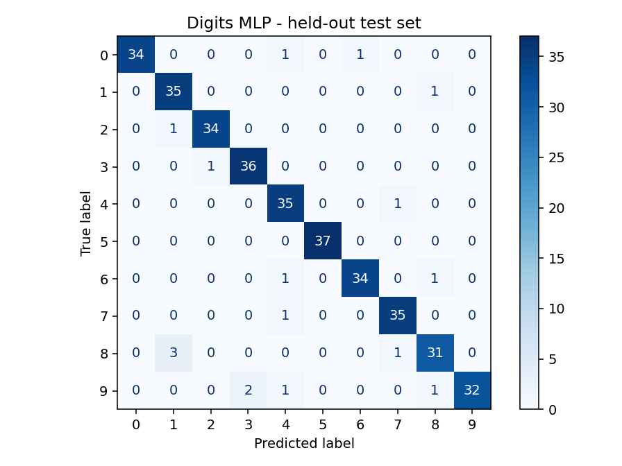
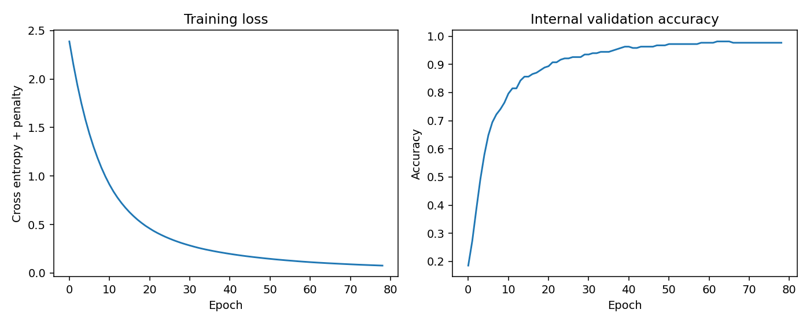

# Artificial Intelligence Labs · Python

**Nedim Omanović** · [GitHub](https://github.com/NedimOmanovic04)

Portfolio laboratorijskih vježbi iz vještačke inteligencije: od obrade podataka i osnovnih Python algoritama do treniranja neuronskih mreža, klasifikacije slika, ekspertnih sistema i optimizacije.

**English:** Python AI coursework covering data preprocessing, supervised learning, dense neural networks, CNNs, symbolic reasoning, fuzzy control and evolutionary optimization. A separate reproducible demo trains and evaluates an MLP on handwritten digits with a held-out test set.

## Šta ovaj repozitorij pokazuje

| Vještina | Primjeri u kodu |
| --- | --- |
| Python, funkcije, petlje, liste i matematičke operacije | [LV1](notebooks/LV1.ipynb) |
| NumPy: nizovi, matrice, indeksiranje i transformacije | LV1, LV2 i neuronske mreže |
| Pandas: CSV, filtriranje, nedostajuće vrijednosti i priprema podataka | [LV2](notebooks/LV2.ipynb), [LV3](notebooks/LV3.ipynb) |
| Skaliranje, imputacija i podjela na trening/test skup | LV2, LV3 i [izvršivi demo](examples/demo.py) |
| KNN klasifikacija i evaluacija | LV2 i LV3 |
| TensorFlow/Keras: slojevi, aktivacije, loss, optimizator i epohe | LV2–LV6 |
| Binarna i višeklasna klasifikacija teksta | [LV4](notebooks/LV4.ipynb) |
| Regresija neuronskom mrežom i praćenje greške | [LV5](notebooks/LV5.ipynb) |
| CNN: konvolucija, pooling, dropout i poređenje arhitektura | [LV6](notebooks/LV6.ipynb) |
| Forward/backward chaining i baze pravila | [LV7](notebooks/LV7.ipynb), [LV8](notebooks/LV8.ipynb) |
| Genetički algoritmi: selekcija, ukrštanje, mutacija i fitness | [LV9](notebooks/LV9.ipynb) |
| Fuzzy logika: funkcije pripadnosti, pravila i defuzzifikacija | [LV10](notebooks/LV10.ipynb) |
| PSO optimizacija parametara neuronske mreže | [LV11](notebooks/LV11.ipynb) |
| Ponovljiv eksperiment, cross-validation i provjera rezultata | `examples/`, `tests/`, `reports/`, GitHub Actions |

## Pregled laboratorijskih vježbi

| Vježba | Sadržaj | Podaci / napomene |
| --- | --- | --- |
| LV1 | Osnove Pythona, kombinatorika, matrice, sin/cos grafici | Neke ćelije traže unos kroz `input()` |
| LV2 | Pandas, imputacija, normalizacija, KNN, dense mreža | `izvjestaj.csv`, Iris, MNIST |
| LV3 | Klasifikacija vina, dense mreže, utjecaj skaliranja | `winequality-red.csv`, `winequality-white.csv`, Iris; Colab ćelije |
| LV4 | Spam filter i klasifikacija StackOverflow pitanja | `SpamDetectionData.txt`, `stackoverflow.csv` |
| LV5 | Neuronska regresija i poređenje dužine treniranja | Keras Boston Housing; historijski nastavni primjer |
| LV6 | CIFAR-10 CNN, baseline i dropout varijante | Učitavanje stvarnog CIFAR-10 skupa preko Keras-a |
| LV7 | Porodične relacije i vremenski ekspertni sistem | Python implementacija u PyKE stilu |
| LV8 | Backward chaining, dokazivanje i baza pitanja | Python implementacija; dio traži interaktivni unos |
| LV9 | Rastrigin, Drop-Wave i problem osam kraljica | Stohastička optimizacija |
| LV10 | Fuzzy sistem za preporuku napojnice | `scikit-fuzzy`, trougaone i trapezoidne funkcije |
| LV11 | Iris mreža 4–20–3, treniranje težina pomoću PSO | `pyswarms`, Keras loss; stohastički rezultat |

## Pokreni kompletan mali eksperiment

Potrebni su Python 3.12 i terminal otvoren u korijenu repozitorija. Demo koristi ugrađeni `sklearn` digits skup: 1.797 slika veličine 8×8, deset klasa. Nije potrebno preuzimati CSV niti imati GPU.

```bash
python -m venv .venv
# Windows PowerShell:
.venv\Scripts\Activate.ps1
# macOS/Linux: source .venv/bin/activate
python -m pip install -r requirements.txt
python examples/demo.py
python -m unittest discover -s tests -v
python tools/validate_notebooks.py
```

Tok eksperimenta:

1. Stratifikovana podjela: 80% trening, 20% odvojeni test, seed 42.
2. `StandardScaler` i `MLPClassifier` u istom pipelineu; scaler se uči samo na trening dijelu svakog folda.
3. Mreža sa 32 skrivena neurona; najviše 200 epoha, early stopping i interna validacija od 15% trening podataka.
4. Izbor regularizacije `alpha` kroz stratifikovani trostruki cross-validation, prema macro F1. Test skup ne bira hiperparametre.
5. Ponovno treniranje najbolje konfiguracije na trening skupu, zatim test accuracy, macro F1, izvještaj po klasama i confusion matrix.
6. Poređenje s `DummyClassifier` modelom koji uvijek predviđa najčešću trening klasu.

Rezultati se zapisuju u [metrics.json](reports/metrics.json), [confusion matrix](reports/confusion-matrix.png) i [krivulje treniranja](reports/training-curves.png). Datoteka metrika bilježi konfiguraciju i verzije biblioteka. Za ponavljanje provjerenog demo okruženja koristi `requirements-lock.txt`.

### Izmjereni demo rezultati

Pokrenuto na Pythonu 3.12.14, scikit-learn 1.5.2.

| Metrika | Izmjereno |
| --- | --- |
| Trening / test uzorci | 1437 / 360 |
| Najbolji CV macro F1 | 0.9296 |
| Test accuracy | 0.9528 |
| Test macro F1 | 0.9526 |
| Dummy test accuracy | 0.1000 |

Ovo su rezultati dodatnog MLP primjera, a ne ponovno izmjerene metrike TensorFlow laboratorija.





## Otvaranje notebooka

```bash
python -m pip install -r requirements-labs.txt
python -m jupyter lab
```

Detalje o CSV datotekama vidi u [data/README.md](data/README.md). Za Colab se notebook može ručno otvoriti preko **File → Open notebook → GitHub**. `google.colab` ćelije rade u Colabu; lokalno ih preskoči ili zamijeni lokalnim putanjama. Notebooke pokreći od početka uz svježe pokrenut kernel.

## Obim provjere i ograničenja

- Notebooki su arhiva dostavljenih laboratorijskih radova. Struktura i Python sintaksa su provjerene; sve TensorFlow/CNN/PSO vježbe nisu ponovo trenirane u ovoj portfolio pripremi.
- Sačuvani ispisi i metapodaci su uklonjeni. Sačuvani tekstualni zaključci u notebookima pripadaju izvornim vježbama i nisu nove potvrđene metrike.
- Eksterni nastavni CSV skupovi nisu uključeni. Neke ćelije imaju Colab putanje ili pretpostavljaju prethodno učitane podatke.
- Simbolički ekspertni sistemi su Python implementacije u PyKE stilu, bez tvrdnje da koriste originalni PyKE engine.
- Boston Housing je zadržan kao historijski nastavni primjer; rezultat nije model za savremenu procjenu cijena nekretnina.
- Seed olakšava ponavljanje demo primjera; verzije biblioteka i računarska platforma mogu promijeniti rezultat. Demo je obrazovni eksperiment na malom benchmark skupu.

## Porijeklo i priprema portfolija

Osnova su postojeće datoteke `LV1`–`LV11` iz lokalnog nastavnog materijala. `LV3` je dobio nastavak `.ipynb`; u LV1 je uklonjen zalutali znak `1` iza `print(...)`, koji je izazivao sintaksnu grešku. U objavljenoj kopiji LV6 sintetički placeholder sa nasumičnim pikselima i labelama zamijenjen je stvarnim `cifar10.load_data()` učitavanjem. Ranije sačuvani rezultati ne koriste se kao dokaz performansi. Ova izmjena nije potvrđena ponovnim CNN treniranjem. Originalne lokalne datoteke nisu izmijenjene.

Dokumentacija, demo, testovi i CI dodani su uz pomoć AI asistenta tokom pripreme portfolija. Oni su označeni kao dodatni reproduktibilni primjer, odvojeno od izvornih laboratorijskih vježbi. Repozitorij prikazuje konkretne radove i pokretljiv kod; ne tvrdi profesionalno iskustvo ili samostalno autorstvo svakog nastavnog zadatka.

Srodni projekat: [Probability and Statistics with Python](https://github.com/NedimOmanovic04/probability-and-statistics-python).

Stratifikovanih 10% trening skupa u LV6 odvojeno je za validaciju; zvanični test skup koristi se za evaluaciju. Arhitekture se porede obrazovno; nezavisna konačna procjena nakon izbora arhitekture zahtijevala bi dodatni odvojeni skup.
